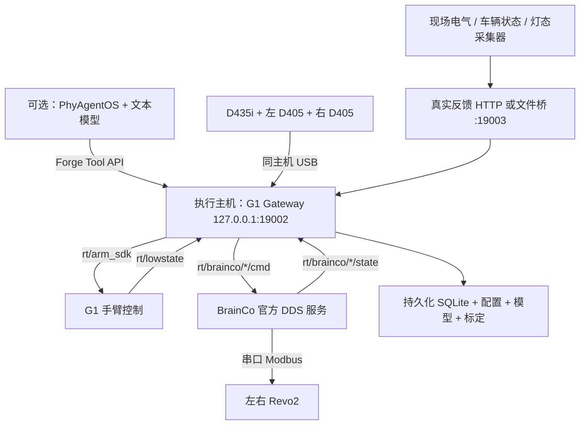

# G1 Linux 部署与真机接入手册

源码仓库：[zztyac/phyagent](https://github.com/zztyac/phyagent)，部署分支：[`codex/g1-console-pick-runtime`](https://github.com/zztyac/phyagent/tree/codex/g1-console-pick-runtime)。G1 运行时基线提交 `f657e3e`；本手册更新日期：2026-10-10。每次部署以实际 `git rev-parse HEAD` 为准，将完整提交号写入现场记录。

适用硬件：**Unitree G1 EDU 29 DOF、BrainCo Revo2 六通道左右手、头部 D435i、左右腕 D405**。任务为固定基座下的汽车中控台物理按键和已知刚性小物体 Pick / Place；不使用 VLA。用户目前仅确认 BrainCo 品牌，**实际型号、固件和六通道协议兼容性仍须核实**。

这是一份部署和分阶段接机操作手册。代码已经做过离线测试，尚未连接用户的机器人、相机或车辆；安装成功、`doctor` 通过、HTTP `ready=true` 均不代表实机任务已通过验收。现有验证证据见 [VALIDATION.md](VALIDATION.md)。

## 目录

1. [架构、主机与准备清单](#architecture)
2. [从个人仓库克隆与建立 Linux 环境](#linux)
3. [不接真机的运行验证](#offline)
4. [Unitree、BrainCo 与三相机](#drivers)
5. [现场配置、模型与标定](#calibration)
6. [按键真实反馈](#feedback)
7. [分阶段接机与 API 操作](#commissioning)
8. [接入 PhyAgentOS / Dora](#core)
9. [日常启动、停机、更新与恢复](#operations)
10. [排查、验收与交付](#acceptance)
11. [上游资料](#references)

配套可填写文件：[SITE_ACCEPTANCE.zh-CN.md](SITE_ACCEPTANCE.zh-CN.md)。简要坐标说明：[COMMISSIONING.md](COMMISSIONING.md)。完整参数模板：[real.site.template.json](config/real.site.template.json)，字段约束：[runtime.schema.json](config/runtime.schema.json)。

首次部署按以下顺序进行。只做独立 API 按键/抓放任务时，第 8 节为可选项，无须模型 API Key。

| 顺序 | 阅读与执行 | 完成后可做什么 |
| --- | --- | --- |
| 1 | 第 2–3 节：clone、安装、Mock | 不接硬件验证按键→抓取→放置的软件链路 |
| 2 | 第 4–6 节：SDK、设备、配置、模型、标定和反馈 | 准备真实接机所需数据与服务 |
| 3 | 第 7 节：只读接机→单键→Pick/Place | 逐项验收后使用已配置的真实目标 |
| 4 | 第 8 节，可选：Dora / Core | 托管 Skill，按需增加文本模型入口 |
| 5 | 第 9–10 节：运维与验收记录 | 固定可复现版本，按流程更新和恢复 |

<a id="architecture"></a>
## 1. 架构、主机与准备清单

### 1.1 推荐的第一套部署

使用一台 **Ubuntu 22.04 x86_64、Python 3.11** 的执行主机，通过有线网卡接入 G1 的开发网络，三路相机直接通过 USB 接入该主机。模型规划只在本地使用几何、IK、碰撞检测与状态机，运行执行层不需要 GPU、模型 API 或 ROS。

本次 Linux 软件验证在 Ubuntu 22.04 WSL / Python 3.11.13 完成；这不是 WSL 真机 USB、DDS、实时性验收。首次接机建议原生 Linux。aarch64/Jetson 可作为后续部署目标，但目前没有完成其原生依赖、性能和实机验收，不能把 x86_64 的环境复制过去直接使用。



BrainCo 服务部署在**实际插着手部 USB 串口的主机**：可以是执行主机，也可以是机器人 PC2；只要 DDS 网络互通。三相机则必须对运行 Gateway 的主机本地可见，本版没有网络相机转发适配。先确认 G1 头相机 USB 接在哪里，不要把厂商网络视频流当成 `pyrealsense2` 本地设备。

| 进程 / 接口 | 所在位置 | 用途 |
| --- | --- | --- |
| G1 Gateway | 执行主机，单进程 | 绑定 `127.0.0.1:19002`，只运行一份 |
| `brainco_hand_server` | 手部串口所在主机 | 一个服务可发现左右两手；不能让两份服务占同一串口 |
| 真实反馈采集进程 | 反馈设备所在主机 | 由现场提供；不是机器人动作结果的模拟器 |
| `feedback-bridge`，可选 | 执行主机 | 绑定 `127.0.0.1:19003`，只读源文件 |
| Dora + Core，可选 | 首次建议同一执行主机、同一用户 | 管理 Skill，调用 Gateway；不再额外启动独立 `serve` |
| HTTP 静态索引，安装时使用 | `127.0.0.1:18080` | 安装 Skill/Node 归档；安装完成可停止 |

左右臂共享一个工作区锁，任务**串行执行**。一手确认持物后另一手可执行经过碰撞检查的任务；可能持物、未知结果、重启后未核实持物会阻止继续运动。不是同时双臂协调控制。

### 1.2 到现场前必须收集

| 内容 | 最低交付要求 |
| --- | --- |
| G1 | 序列号、29 DOF 型号、固件、允许的 `arm_sdk` 控制模式、控制权交接方法、物理停机方法 |
| 固定方式 | 腿/腰/基座保持标定姿态的方案；本项目不维持平衡、不移动机器人 |
| BrainCo | 两手完整型号/尺寸/固件、六通道顺序、供电、串口位置、已有服务、自启动与断连行为 |
| 相机 | 三个序列号、固件、USB 拓扑、安装支架、支持的彩色和深度视频模式 |
| 模型 | 对应 29 DOF 的 URDF/mesh、碰撞 SRDF、手与相机包络、左右 wrist frame 名称 |
| 面板 | 安装姿态、每个按键 ID/中心/方向/可用面积/行程、指尖端头尺寸、可归因反馈通道 |
| Pick | 物体质量、尺寸、抓持方式、标记可见性、放置区、台面和障碍物尺寸 |
| 控制参数 | 双臂增益、限位、电流界限、低速调试结果；由厂家与现场确定 |

尤其要提前确定“按键是否真正触发”的信号来源。项目已实现反馈协议和文件桥，**没有实现你这辆车专属的 CAN/电气/灯态采集驱动**，也没有从照片自动识别所有按钮的功能。

<a id="linux"></a>
## 2. 从个人仓库克隆与建立 Linux 环境

### 2.1 直接 clone 你的仓库

在 Linux 的普通部署用户下执行；`sudo` 只用于系统依赖和需要特权的设备配置。以下将源码放在 `$HOME/phyagent`，该目录应尚不存在：

```bash
sudo apt update
sudo apt install -y git ca-certificates
cd "$HOME"
git clone --depth 1 --branch codex/g1-console-pick-runtime https://github.com/zztyac/phyagent.git phyagent
cd "$HOME/phyagent"
git remote get-url origin
git branch --show-current
git log -1 --oneline
git status --short
test -f integrations/g1-tabletop/DEPLOYMENT_LINUX.zh-CN.md
```

预期 `origin` 为 `https://github.com/zztyac/phyagent.git`，分支为 `codex/g1-console-pick-runtime`，工作区无改动。`--depth 1` 减少历史文件下载，不影响安装和后续 `git pull --ff-only`。部署无需获取完整历史。

**必须指定该 G1 分支**；原始上游的 `v1.1.0` 标签不包含此集成，不要按上游旧教程切换到该标签。Linux 新 clone 的远程名就是 `origin`，开发电脑使用的 `personal` 远程名不会随 clone 复制，也无需在 Linux 添加。

如果已按上述路径克隆，日后按第 9.6 节更新，不重复 clone 或覆盖目录。GitHub 访问失败先解决执行主机网络；私有仓库使用自己的 GitHub 凭据或 SSH 密钥，不把令牌写入命令、文档或现场配置。

clone 后的交付范围：

| 已在仓库中 | 仍需在 Linux 安装或现场提供 |
| --- | --- |
| Core、G1 源码、Mock、测试、配置模板、部署文档 | Python 环境、系统/原生依赖、Unitree / BrainCo SDK 与服务 |
| Skill/Node 构建脚本、依赖约束、上游参考提交 | 本机重建的 Skill/Node 归档；`dist/` 不在 Git 中 |
| 标定算法、字段格式、反馈协议及文件桥 | 真实 URDF/mesh/SRDF、相机/TCP 标定、手型/增益、车辆反馈采集器 |

`.venv`、现场配置、模型和执行数据库不会通过 clone 自动获得。不要复制 Windows 虚拟环境到 Linux；本手册以下步骤在 Linux 重新建立环境。

### 2.2 统一路径约定

后续示例均使用 Bash。先建立路径约定；自选安装目录时在这里替换，保持源码和现场数据分开：

```bash
export G1_REPO="$HOME/phyagent"
export G1_SITE="$HOME/g1-site"
cd "$G1_REPO"
mkdir -p "$G1_SITE"/{config,models,calibration,feedback,logs,state,backups,upstream}
cp -n integrations/g1-tabletop/SITE_ACCEPTANCE.zh-CN.md "$G1_SITE/logs/site-acceptance.md"
```

| 路径 | 保存内容 |
| --- | --- |
| `$G1_REPO`，默认 `$HOME/phyagent` | 当前版本源码，Git 更新只在此目录进行 |
| `$G1_SITE`，默认 `$HOME/g1-site` | 本机持久资料，独立于 Git 仓库 |
| `$G1_SITE/venv/` | Linux Python 环境，不随源码推送或迁移 |
| `$G1_SITE/config/runtime-env.sh` | 第 2.5 节生成的终端环境入口 |
| `$G1_SITE/config/site.json` | 现场真实配置，使用绝对资产路径 |
| `$G1_SITE/models/` | URDF、SRDF、完整 mesh 目录 |
| `$G1_SITE/calibration/` | 原始配对数据、外参、TCP 测量与标记图片 |
| `$G1_SITE/state/real/runtime.sqlite3` | 真实执行记录、占用和幂等状态，必须持久保留 |
| `$G1_SITE/state/mock/runtime.sqlite3` | 独立 Mock 数据库 |
| `$G1_SITE/feedback/` | 现场采集器生成的反馈文件 |
| `$G1_SITE/logs/` | 部署快照、执行证据与 `site-acceptance.md` 验收记录 |

不要把真实状态目录放在临时目录、容器临时层或每次发布都会删除的构建目录。所有运行/维护命令使用同一用户、同一状态路径。

### 2.3 系统依赖与 Python

以下面向 Ubuntu 22.04；其他发行版需替换包名。Ubuntu 22.04 系统 Python 通常是 3.10，不能直接用于本项目。

```bash
sudo apt update
sudo apt install -y git curl ca-certificates build-essential cmake pkg-config \
  python3-pip python3-venv libusb-1.0-0-dev libudev-dev \
  libgl1 libglib2.0-0 libspdlog-dev libfmt-dev \
  libboost-program-options-dev libyaml-cpp-dev

# uv 用于提供独立 Python 3.11；不替换系统 Python。
python3 -m pip install --user uv
export PATH="$HOME/.local/bin:$PATH"
uv python install 3.11
uv venv --python 3.11 --seed "$G1_SITE/venv"
source "$G1_SITE/venv/bin/activate"
python --version
python -m pip install --upgrade pip
```

以上创建环境命令用于首次安装；已有 `$G1_SITE/venv` 时直接激活，不重新创建。若系统禁止 `pip --user`，按 [uv 官方安装说明](https://docs.astral.sh/uv/getting-started/installation/)安装 uv，不修改系统 Python 的管理策略。如果使用已有且经验证的 Conda/Python 3.11 环境，需同步修改第 2.5 节的激活语句；所有 Python、`paos` 和 Dora Node 必须指向同一环境。

### 2.4 安装项目与原生库

```bash
cd "$G1_REPO"
python -m pip install \
  -c integrations/g1-tabletop/requirements-native-linux.txt \
  -e '.[dev]' -e 'integrations/g1-tabletop[dev]' \
  'opencv-python==4.14.0.94'
python -m pip install -r integrations/g1-tabletop/requirements-native-linux.txt
python -m pip check
python - <<'PY'
import cv2
import numpy
import pinocchio
import coal
for name in ('ArucoDetector', 'DetectorParameters', 'generateImageMarker'):
    assert hasattr(cv2.aruco, name), name
assert hasattr(cv2, 'calibrateHandEye')
print('OpenCV', cv2.__version__, 'NumPy', numpy.__version__)
print('Pinocchio', pinocchio.__version__, 'coal import OK')
PY
```

本手册统一使用一个 `opencv-python` 发行包，以满足 Unitree SDK 的依赖声明；上述现代版本提供本项目所需 ArUco API，所以此处**不同时安装 `[vision]` extra**。该 extra 会安装 `opencv-contrib-python-headless`。四种 OpenCV pip 发行包共享 `cv2` 文件，不能混装。已有环境若混装，应在独立环境中清除四种 OpenCV 包后仅装选定版本，并重新验证视觉功能。

Pinocchio 使用 pip 包名 `pin`，不是名为 `pinocchio` 的其他包。已验证的原生组合为 `pin 3.9.0 / coal 3.0.2 / eigenpy 3.12.0 / cmeel-urdfdom 4.0.1 / cmeel-tinyxml2 10.0.0 / numpy 2.3.5`。不能只升级其中一个库；`undefined symbol` 通常是 ABI 混配。

首次安装需要网络。离线交付时，在相同 Linux 架构/Python 的已验证环境准备 wheelhouse、系统软件包和上游源码，另保存 `pip freeze`；仅复制 Node 归档无法替代这些依赖。

### 2.5 保存环境，供每个新终端使用

在上面已经设置 `G1_REPO` / `G1_SITE` 的终端执行一次。脚本保存实际绝对路径，并保留已存在的文件：

```bash
python - <<'PY'
import os
import shlex
from pathlib import Path

repo = Path(os.environ['G1_REPO']).resolve()
site = Path(os.environ['G1_SITE']).resolve()
target = site / 'config/runtime-env.sh'
content = (
    f'export G1_REPO={shlex.quote(str(repo))}\n'
    f'export G1_SITE={shlex.quote(str(site))}\n'
    'export PATH="$HOME/.local/bin:$HOME/.cargo/bin:$PATH"\n'
    'source "$G1_SITE/venv/bin/activate"\n'
    'export CYCLONEDDS_HOME="$G1_SITE/upstream/cyclonedds/install"\n'
    'export G1_REAL_CONFIG="$G1_SITE/config/site.json"\n'
    'export G1_TABLETOP_STATE_DIR="$G1_SITE/state"\n'
    'export LITELLM_LOCAL_MODEL_COST_MAP=True\n'
)
try:
    with target.open('x', encoding='utf-8') as output:
        output.write(content)
    print('Created:', target)
except FileExistsError:
    print('Kept existing file; check its paths:', target)
PY
source "$G1_SITE/config/runtime-env.sh"
```

**后续每个新终端先执行下面两行，再运行本手册命令**；自选现场资料目录时替换第一行路径：

```bash
source "$HOME/g1-site/config/runtime-env.sh"
cd "$G1_REPO"
```

此时 real 配置和 CycloneDDS 目录尚不存在是正常的，第 4–5 节才建立它们；设置路径不会连接设备或开启 real 模式。DDS 网卡按第 4.1 节核实后再填写，不在环境文件中预填机器人网卡。

<a id="offline"></a>
## 3. 不接真机的运行验证

```bash
cd "$G1_REPO"
export LITELLM_LOCAL_MODEL_COST_MAP=True
python -m g1_tabletop --help
python -m g1_tabletop demo
python -m g1_tabletop doctor --config integrations/g1-tabletop/config/mock.json
python -m pytest integrations/g1-tabletop/tests -q
```

`demo` 应完成模拟按键→左手抓取→放置，输出 `physical_hardware_used: false`。`doctor` 应输出 `config_valid: true`、`devices_connected: false`。测试数量以当前版本为准；基线 Linux 完整环境为 67 passed，测试不是物理仿真或真实成功率。

启动独立 Mock Gateway，保持终端前台运行：

```bash
python -m g1_tabletop serve \
  --config "$G1_REPO/integrations/g1-tabletop/config/mock.json" \
  --state-dir "$G1_SITE/state" --require-mode mock --port 19002
```

另一个终端检查：

```bash
curl --fail-with-body --noproxy '*' http://127.0.0.1:19002/health
curl --fail-with-body --noproxy '*' http://127.0.0.1:19002/tools
```

API 文档：`http://127.0.0.1:19002/docs`。图像 WebSocket `/ws/images` 的 Mock 输出是占位图，不能用来评价真实视觉。按第 7.3 节的 Mock 示例检查 HTTP 动作链路。完成后 Ctrl+C 退出，再安装硬件层；不要让 Mock Gateway 占着 real profile 所需端口。

<a id="drivers"></a>
## 4. Unitree、BrainCo 与三相机

### 4.1 G1 网络和控制权限

由厂家确认本机固件允许的手臂 SDK 工作模式、支撑姿态和控制权交接步骤。保持腿/腰/基座固定。本项目只发布 `rt/arm_sdk`，不会发布整机 `rt/lowcmd`；不要照搬针对 Go2 或全身低层控制的示例去关闭 G1 所需的平衡/运动服务。

```bash
ip -br address
ip route
timedatectl status
```

记录连接机器人网络的实际网卡，例如 `enp3s0`；G1 的 IP、子网、静态地址由现场网络决定，本手册不假设出厂地址。DDS 需要正确网卡、同一 domain、可达的发现/数据通信；能 ping 通不等于 DDS 已互通。VPN、Wi-Fi 优先路由、防火墙、多网卡均需检查，不要以关闭全部防火墙代替定位。

确认后将 `export G1_DDS_INTERFACE=实际网卡名` 加到本机 `$G1_SITE/config/runtime-env.sh`，重新 source，并将同一网卡填入现场配置的 `hardware.interface`。环境变量供本手册诊断和服务命令使用，Gateway 读取 JSON 配置，不会用环境变量自动替换该字段。

本版 BrainCo 上游服务固定 `domain_id=0`，所以当前部署 `hardware.domain_id` 也使用 0。项目配置虽然允许其他数字，但必须改造并重新验收手部服务后才能一起更改。

### 4.2 安装 Python SDK2 和 CycloneDDS

SDK 固定提交见 [references.lock.json](references.lock.json)。先构建 SDK README 指定的 CycloneDDS 0.10 系列，再安装 Python SDK：

```bash
cd "$G1_SITE/upstream"
git clone --branch releases/0.10.x https://github.com/eclipse-cyclonedds/cyclonedds.git
git -C cyclonedds rev-parse HEAD > "$G1_SITE/logs/cyclonedds.commit"
cmake -S cyclonedds -B cyclonedds/build \
  -DCMAKE_INSTALL_PREFIX="$G1_SITE/upstream/cyclonedds/install"
cmake --build cyclonedds/build --target install --parallel 4
export CYCLONEDDS_HOME="$G1_SITE/upstream/cyclonedds/install"

git clone https://github.com/unitreerobotics/unitree_sdk2_python.git
git -C unitree_sdk2_python checkout --detach 814556d15970dd2ecf1c9984e845ca02ab07e206
python -m pip install \
  -c "$G1_REPO/integrations/g1-tabletop/requirements-native-linux.txt" \
  -e "$G1_SITE/upstream/unitree_sdk2_python"
python -m pip check
python - <<'PY'
import cyclonedds
from unitree_sdk2py.core.channel import ChannelFactoryInitialize, ChannelSubscriber
from unitree_sdk2py.idl.unitree_hg.msg.dds_ import LowState_
from unitree_sdk2py.utils.crc import CRC
print('SDK / CycloneDDS imports OK; no device connection or publication')
PY
```

`releases/0.10.x` 是移动分支：首次下载后记录的 SHA 才是本次实际版本，以后的复现 checkout 该 SHA，不重新跟随分支。Python `cyclonedds` 由 SDK 固定为 `0.10.2`。如果另有 ROS/CycloneDDS 环境，不要混用其 `LD_LIBRARY_PATH` 或 CMake 路径；先验证独立终端中的实际加载库。

读取 G1 状态时可使用下面的**仅订阅**诊断。它不创建命令发布者，也不替代现场静止姿态的重复测量：

```bash
export G1_DDS_INTERFACE=enp3s0   # 改成已经核实的网卡
python - <<'PY'
import json
import os
import threading
from unitree_sdk2py.core.channel import ChannelFactoryInitialize, ChannelSubscriber
from unitree_sdk2py.idl.unitree_hg.msg.dds_ import LowState_

received = threading.Event()
sample = {}
def on_state(msg):
    if received.is_set() or len(msg.motor_state) < 29:
        return
    sample.update(
        body_q=[float(m.q) for m in msg.motor_state[:15]],
        arm_q_left_then_right=[float(m.q) for m in msg.motor_state[15:29]],
        imu_wxyz=[float(x) for x in msg.imu_state.quaternion],
        mode_machine=int(msg.mode_machine),
    )
    received.set()

ChannelFactoryInitialize(0, os.environ['G1_DDS_INTERFACE'])
subscriber = ChannelSubscriber('rt/lowstate', LowState_)
subscriber.Init(on_state, 1)
try:
    if not received.wait(5):
        raise SystemExit('No HG lowstate: check interface/domain/firmware/network')
    print(json.dumps(sample, indent=2))
finally:
    subscriber.Close()
PY
```

若无消息，先解决网络/固件/类型问题。不要用发送低层控制命令来“验证网络”。

### 4.3 安装 BrainCo C++ 服务

此节在手部串口所在主机执行。其 C++ `unitree_sdk2` 依赖独立于 Python SDK；机器人 PC2 若已由厂家安装匹配版本，先记录版本和路径，不重复覆盖系统库。

如需新装 C++ SDK，可按以下构建方式准备。`UNITREE_CPP_REF` 必须填供应商确认的完整提交 SHA；该 C++ 仓库未列入本项目原有四项参考锁，不能声称已有固定版本完成实机验证。

```bash
# 先在终端将 UNITREE_CPP_REF 设为厂家确认的完整提交 SHA。
: "${UNITREE_CPP_REF:?请先设置厂家确认的 C++ SDK 提交 SHA}"
cd "$G1_SITE/upstream"
git clone https://github.com/unitreerobotics/unitree_sdk2.git
git -C unitree_sdk2 checkout --detach "$UNITREE_CPP_REF"
cmake -S unitree_sdk2 -B unitree_sdk2/build \
  -DBUILD_EXAMPLES=OFF -DCMAKE_INSTALL_PREFIX=/usr/local
cmake --build unitree_sdk2/build --parallel 4
sudo cmake --install unitree_sdk2/build
sudo ldconfig
git -C unitree_sdk2 rev-parse HEAD > "$G1_SITE/logs/unitree-sdk2-cpp.commit"

git clone https://github.com/unitreerobotics/brainco_hand_service.git
git -C brainco_hand_service checkout --detach d71996b6999edb2f838a3dca3d9621429a2ef966
cmake -S brainco_hand_service -B brainco_hand_service/build
cmake --build brainco_hand_service/build --parallel 4
"$G1_SITE/upstream/brainco_hand_service/bin/brainco_hand_server" --help
ldd "$G1_SITE/upstream/brainco_hand_service/bin/brainco_hand_server"
```

检查 `ldd` 没有 `not found`。CMake 引用仓库的 `lib/x86_64` 或 `lib/aarch64` 中 BrainCo 库；保留这些文件及其许可证，不只复制可执行文件。若动态库未找到，核实安装路径/RUNPATH，在该服务专用启动环境配置实际库目录，避免给所有 Python 进程注入不同版本的 DDS 库。

上游协议已核对：

| 项 | 固定参考版本的行为 |
| --- | --- |
| 串口 | 扫描 `/dev/ttyUSB*`、`/dev/ttyHAND*`、`/dev/ttyUN*`，Modbus 460800 baud |
| 左右地址 | 左 `0x7e`，右 `0x7f`，需要匹配可识别的 Revo2 SKU |
| 六通道 | Thumb、Thumb_aux、Index、Middle、Ring、Pinky；仍需实测各通道方向 |
| 命令 | 位置 q、速度 dq 归一化到 `[0,1]` |
| 状态 | `tau_est` 实际是电流 A，不是扭矩或指尖力 |
| DDS | `rt/brainco/left/{cmd,state}`、`rt/brainco/right/{cmd,state}`，domain 0 |
| 参数 | `--network_interface` 或 `-n`；使用完整参数名 |

检查串口权限；可以按现场策略把服务用户加入 `dialout` 并重新登录，或安装针对设备的 udev 规则。不要让两个服务打开同一串口，也不要在已有厂家服务运行时另起一份。

**启动行为必须纳入接机验收：该上游服务不是只读程序。** 工作线程启动后，以默认 q=0、dq=1 持续发送命令，可能立即打开/移动手指；收到命令后持续重发最近目标，没有看到基于命令年龄的超时看门狗。不能在手持物体时把“重启服务”当作无害恢复。

仅在双手空载、运动范围清空、现场允许手指动作后，前台启动：

```bash
"$G1_SITE/upstream/brainco_hand_service/bin/brainco_hand_server" \
  --network_interface "$G1_DDS_INTERFACE"
```

在 PC2 上运行时，`G1_DDS_INTERFACE` 应是 **PC2 自己的网卡名**。观察日志识别出左右两手。其测试程序 `test_brainco_hand_server` 会反复握拳/张开，不能当只读检查；不要在 Gateway 控制期间运行。首次阶段不使用上游自启动脚本，待启动、退出和断连行为全部验收后再设计服务管理。

### 4.4 RealSense 安装与设备检查

在执行主机安装：

```bash
python -m pip install \
  -c "$G1_REPO/integrations/g1-tabletop/requirements-native-linux.txt" pyrealsense2
lsusb -t
python - <<'PY'
import pyrealsense2 as rs
devices = list(rs.context().query_devices())
for device in devices:
    print(device.get_info(rs.camera_info.name),
          device.get_info(rs.camera_info.serial_number),
          device.get_info(rs.camera_info.firmware_version))
print('device count:', len(devices))
PY
```

应看到 D435i 和两个 D405。`pyrealsense2` wheel 不替你配置所有系统 USB 权限；按 [librealsense Linux 安装说明](https://github.com/realsenseai/librealsense/blob/master/doc/installation.md)安装匹配的 udev 规则和需要的 Viewer/工具，记录版本。没有该 Python/架构的 wheel 时按上游方式编译绑定，不改装不匹配的 wheel。

逐相机在 RealSense Viewer 检查，再同时检查三路：

- USB 3 链路、线缆长度、供电和 USB 控制器带宽足够；避免三个高带宽设备挤在不合适的 Hub。
- 每台相机必须同时支持配置中的同尺寸彩色 `bgr8` 和深度 `z16`，默认 `640×480@30`，可选 15/30 fps。模板值不是对所有固件的视频模式承诺。
- 驱动开启可用的 `global_time_enabled`；接受 system/global time，主机时钟差超过 0.5 秒会拒绝，帧接收后超过 0.3 秒会过期。
- 实际相机畸变应属于 none、brown_conrady 或 modified_brown_conrady；其他模型本版拒绝。
- 关闭 Viewer/其他采集程序释放设备后再启动 Gateway。不要为消除报错直接放宽时间、重投影门限。

相机序列号写入对应 `head/left_wrist/right_wrist`，不能依赖枚举顺序。深度会被采集并对齐，目标定位主链仍是**已知尺寸 ArUco 标记 PnP**，不是深度图自动寻找黑色反光按钮。

<a id="calibration"></a>
## 5. 现场配置、模型与标定

### 5.1 建立配置草稿

```bash
cp -n "$G1_REPO/integrations/g1-tabletop/config/real.site.template.json" \
  "$G1_SITE/config/site.json"
export G1_REAL_CONFIG="$G1_SITE/config/site.json"
export G1_TABLETOP_STATE_DIR="$G1_SITE/state"
```

模板中的 `null` 均需实测，`commissioned=false` 故意让 real 配置不能加载。不能从 Mock 复制几何/增益，也不能只将 Mock 的 `mode` 改成 real。`mock_pose/mock_panel_pose` 是兼容字段，实机定位不使用这些数值。

草稿阶段只做 JSON 格式检查与缺项清单：

```bash
python - <<'PY'
import json
import os
from pathlib import Path
data = json.loads(Path(os.environ['G1_REAL_CONFIG']).read_text())
def missing(value, path=''):
    if value is None:
        print(path, '= null')
    elif isinstance(value, dict):
        for key, item in value.items():
            missing(item, f'{path}.{key}' if path else key)
    elif isinstance(value, list):
        for index, item in enumerate(value):
            missing(item, f'{path}[{index}]')
    elif isinstance(value, str) and 'REPLACE' in value:
        print(path, '=', value)
missing(data)
print('commissioned:', data['commissioned'])
PY
```

该清单不验证数值正确性。现场配置、厂家独立调试、标定和首次动作条件检查完成后，操作员才可声明 `commissioned=true` 并运行 `doctor`。这表示**允许进入受控接机验证的人工声明**，不是已达到任务成功率的认证；任务验收另记在配套记录表。当前 `doctor` 不支持绕过此声明检查 real 草稿。

### 5.2 字段填写说明

| 字段组 | 填什么、从哪里来 |
| --- | --- |
| `calibration_id` | 唯一现场标定版本，如面板/支架/TCP 变更后产生新 ID |
| `limits.workspace` | base 坐标下允许的 TCP 包围盒，结合座舱障碍测量 |
| `limits.*speed* / *acceleration* / joint_step_rad` | 现场验证的速度、加速度与关节步长；模板不是生产参数 |
| `position/orientation_tolerance` | 按键可用面积、重复定位误差和实测精度共同确定 |
| `state/feedback_max_age_s` | 设备消息和真实反馈最大年龄，结合实测延迟确定 |
| `hardware.interface/domain_id/firmware_id` | 网卡、当前 domain 0、现场固件记录；固件字符串不是自动版本握手 |
| `urdf/srdf/mesh_directory` | Linux 绝对路径；不要填 Windows 盘符或依赖工作目录 |
| `urdf_sha256/srdf_sha256` | 最终模型文件哈希，模型改动就重新计算和验收 |
| `wrist_frames` | URDF 左右腕参考坐标系名，与 FK 和标定使用同一个 frame |
| `wrist_to_tcp` | 左右 `point` 指尖、`grasp` 抓持中心的完整位姿 |
| `wrist_envelopes` | 各腕坐标系下覆盖手、相机、支架的球 `[x,y,z,r]` 列表，单位 m |
| `reference_body_q` | 固定腿腰姿态的前 15 个关节角，见下节顺序 |
| `reference_imu_wxyz` | 同一静止姿态的单位四元数，注意与 Pose 不同的顺序 |
| `kp/kd/torque_limit_nm/joint_lower_rad/joint_upper_rad` | 14 个值，左臂 7 后右臂 7，厂家确认后低速验证 |
| `postures.*` | 六通道 q、速度、位置容差；必须逐通道实测 |
| `hand_current_limit_a` | 两手适用的已验证电流界限；不是 N 单位接触力 |
| `environment` | base 下静态障碍盒，`size_m` 是完整长宽高；包含中控台、台面等 |
| `cameras.*` | 序列号、parent、外参、实际视频模式和图像时间配对阈值 |
| `panel_marker/buttons` | 面板标记到面板坐标系、各按键接触 TCP 和受限按压参数 |
| `objects/placements` | 物体/放置区标记、目标姿态、支持面、抓持参数和负载包络 |
| `feedback_url/feedback_source` | 真实反馈服务和固定来源标识，见第 6 节 |

纯按键先将 `objects` 和 `placements` 都设为 `{}`，选 `real-buttons` profile。仍须配置两只手、三台相机、左右 `point/grasp` TCP、手/相机包络及维护用张手手型；本版启动健康检查不会因为只按右手按钮就忽略左手和左相机。至少配置一个按键。

### 5.3 模型、坐标和关节顺序

模型必须是**固定基座、恰好 29 个单自由度关节**。不支持 floating base；不要额外加入可动手指自由度。手指、支架用固定连杆和保守包络覆盖。URDF 关节名必须与 [drivers/unitree.py](src/g1_tabletop/drivers/unitree.py) 的 `JOINT_NAMES` 一致。

| 数组位置 / 电机索引 | 顺序 |
| --- | --- |
| `reference_body_q` 0–5 | 左 hip_pitch、hip_roll、hip_yaw、knee、ankle_pitch、ankle_roll |
| 6–11 | 右侧对应 6 个关节 |
| 12–14 | waist_yaw、waist_roll、waist_pitch |
| 臂数组 0–6，电机 15–21 | 左 shoulder_pitch、shoulder_roll、shoulder_yaw、elbow、wrist_roll、wrist_pitch、wrist_yaw |
| 臂数组 7–13，电机 22–28 | 右侧对应 7 个关节 |

HG 命令的槽位 29.q 是 `arm_sdk` 融合权重，不是第 30 个机械关节。本项目首次执行 `prepare/acquire` 时从测量位置建立**双臂**目标并渐增权重，即使动作只选一只手，另一只手也进入保持控制。

所有长度 m、角度 rad；`Pose.quaternion_xyzw` 为单位四元数，IMU 为 **wxyz**。`A_to_B` 表示 B 在 A 坐标中的位姿：

```text
T_base_camera = T_base_wrist × T_wrist_camera       （腕相机）
T_base_target = T_base_camera × T_camera_marker × T_marker_target
T_base_button = T_base_panel × T_panel_button
```

相机外参必须对应采集图像的**彩色光学坐标系**（通常 x 右、y 下、z 前），不是相机外壳 CAD 原点或深度光学系。现场用已知点验证坐标轴和变换方向，不靠名称猜测。

SRDF 只排除经过审查的相邻/永久接触连杆碰撞，不大面积禁用自碰撞。面板、台面、方向盘、座椅、饰板、线缆活动空间都应覆盖。相对 base 固定的环境模型要求安装布局不变。

```bash
sha256sum "$G1_SITE/models/g1-site.urdf" "$G1_SITE/models/g1-site.srdf"
```

把实际文件名和哈希写入配置。mesh 必须可解析且随版本归档；当前检查仅锁定 URDF/SRDF 文件，不自动哈希整个 mesh 目录。可另保存资产目录摘要。

### 5.4 标记、三相机外参与 TCP

生成标记：

```bash
python -m g1_tabletop marker --id 0 --pixels 600 --output "$G1_SITE/calibration/panel.png"
python -m g1_tabletop marker --id 1 --pixels 600 --output "$G1_SITE/calibration/object.png"
python -m g1_tabletop marker --id 2 --pixels 600 --output "$G1_SITE/calibration/placement.png"
```

字典为 `DICT_4X4_50`，ID 0–49，各目标不能重复。打印后用实尺量**黑色正方形边长**填 `size_m`，不含白边。面板标记固定在刚性面板上，不贴在活动按钮上；物体和放置区也要分别有标记。头相机能观察目标，对应腕相机必须在预接触/预抓取位置仍能观察目标。

**本项目提供离线标定求解，不提供自动采集、手动点动或自动标定运动程序。** 先使用厂家确认的调试工具取得初始姿态、逐通道手型、同步图像和关节状态，记录使用的工具版本；本项目不与调试工具同时占用控制权。

每个采样点应保存：图像、内参/畸变、标记尺寸、图像时间戳、配对的 29 关节状态、base→wrist FK 或独立测量的 base→标定板位姿。采集时充分停稳，保持标定板刚性固定；从原图用与运行时一致的光学系/标记定义计算 camera→target。

配对文件结构如下，数值**仅为格式说明，不能用于标定**：

```json
{
  "pairs": [
    {
      "base_to_mount": {"position": [0, 0, 0], "quaternion_xyzw": [0, 0, 0, 1]},
      "camera_to_target": {"position": [0, 0, 1], "quaternion_xyzw": [0, 0, 0, 1]}
    }
  ]
}
```

| 模式 | `base_to_mount` 的含义 | 数量与条件 | 输出 |
| --- | --- | --- | --- |
| `--mount wrist` | 采图时 base→对应 wrist 的 FK | 至少 8 对，围绕至少两个轴充分旋转，标定板静止 | wrist→camera |
| `--mount base` | 独立测量的 base→标定板 | 至少 3 对，不能把待求相机位姿回填为真值 | base→camera |

```bash
python -m g1_tabletop calibrate --mount wrist \
  --input "$G1_SITE/calibration/left-pairs.json" --output "$G1_SITE/calibration/left-camera.json"
python -m g1_tabletop calibrate --mount wrist \
  --input "$G1_SITE/calibration/right-pairs.json" --output "$G1_SITE/calibration/right-camera.json"
python -m g1_tabletop calibrate --mount base \
  --input "$G1_SITE/calibration/head-pairs.json" --output "$G1_SITE/calibration/head-camera.json"
```

输出为 Pose，分别填入 `cameras.left_wrist/right_wrist/head.parent_to_camera`。另测左右 `point` 与 `grasp` TCP。手型可能改变指尖位置，`point` TCP 必须对应实际指向手型和柔顺端头。

用**未参与拟合**的数据验证整个 base→目标→TCP 链路，记录误差均值、最大值和姿态偏差。求解器残差通过不等于满足窄按键精度。腕相机图像与 DDS 使用接收时间近似配对，默认 0.04 秒门限不是硬件同步；运动模糊和延迟必须计入误差预算。

### 5.5 按键和 Pick 参数的现场含义

- `buttons.<id>.pose_in_panel`：刚接触表面时的指尖 TCP 位姿；TCP +Z 与单位 `press_axis_panel` 同向。`precontact_m` 是接触前距离，`travel_m` 是从表面沿按压方向的最大压入量。
- `half_extent_m`：实际允许接触区的半宽/半高，扣除边缘/圆角/邻键；最小半宽必须大于 `contact_tip_radius_m + position_tolerance_m`。碰撞例外只适用于该区域内的指尖，不豁免整只手或相机。
- `dwell_s/settle_s`：按压停留和反馈等待相关时间，需要依据真实消抖/响应延迟测量；模板里的短时间不是可用的实机推荐值。
- `point/open/pinch` 是配置中的命名手型，不是厂家预置动作。左右手共用这些命名 q 数组；若镜像手型不能用相同数值，可以定义独立名称，并让对应按钮/物体引用。实际任务要选择与该手型匹配的手臂，配置不会自动按左右手换算。
- 物体 `marker_to_target` 是期望抓持 TCP；`approach_axis` 当前在 **base** 中解释，抬升沿 base +Z。`payload_radius_m` 是以 grasp TCP 为中心的保守负载球，质量/惯量为近似，不适合长杆或强偏心物体。
- `payload_mass_kg` schema 上限 0.5 kg 不是实际承载保证。选择远小于已确认承载上限的小刚性物体，从低高度、受控支撑面开始。
- 放置区 `marker_to_target` 表示物体放置后的目标中心/TCP 姿态，`support_surface` 必须引用环境盒。验证阶段物体标记应仍可见。

路径采用局部插值、IK 与离散碰撞采样，不是全局绕障规划器。没有公开的 `home`、任意关节点动、`move_to` 或 real 模式“只规划不执行”命令。需要的预姿态、可达性和不接触测试先通过独立调试/离线模型工具完成，不要编造命令或借按键动作在真实面板上试探。

<a id="feedback"></a>
## 6. 按键真实反馈

每个按键需要可归因的真实按下事件，建议先使用独立试验按键和电气采集。车辆接口的接线、信号定义、授权和适配由现场提供；视觉灯态方案需要另实现区域标定、抗反光、迟滞和消抖。

后端读取 `hardware.feedback_url + /buttons/{feedback_key}`，返回**无 Gateway 外层 envelope**的 JSON：

```json
{
  "button_id": "button_01",
  "event_count": 7,
  "state": true,
  "timestamp": 1791500000.123,
  "source": "console-testbench-v1",
  "epoch": "unique-producer-boot-id"
}
```

这只是协议示例，时间戳不是可以反复使用的实时测量。完整定义见 [FEEDBACK.md](FEEDBACK.md)：

- `event_count` 在同一 epoch 内单调增加，一次消抖后的真实按下只加 1，弹起不再加 1。
- `state` 是功能的实际布尔状态，不可观测时为 `null`；此时不能调用 `ensure_state`。
- `timestamp` 是源采样 Unix 秒，持续采样时可刷新测量时间，HTTP 桥不能替旧数据换新时间。
- `source` 固定且等于配置；生产者重启、计数清零、设备更换必须更换 `epoch`。
- 机器人运动完成或发送目标不能产生反馈计数。测试期间避免他人同时按同一个按钮。

使用本项目文件桥时，由现场采集器不断原子替换源文件，格式为：

```text
{"button_01": {该按钮的完整反馈记录}, "button_02": {另一按钮的完整反馈记录}}
```

先写同目录临时文件，flush 后用原子 rename/replace 更新；多个按钮应作为一致快照写入。不要用静态手填 JSON 充当 real 反馈。

```bash
python -m g1_tabletop feedback-bridge \
  --source-file "$G1_SITE/feedback/console.json" --port 19003
```

配置 `feedback_url="http://127.0.0.1:19003"`，`feedback_source` 等于真实记录的 source。另终端：

```bash
curl --fail-with-body --noproxy '*' http://127.0.0.1:19003/buttons/button_01
```

人工按一下试验按钮，确认计数恰加 1、时间新鲜、状态符合事实；反复按/弹起检查消抖，重启采集器检查 epoch 改变。桥对无按钮返回 404、损坏记录返回 503，不提供“写入成功”的接口。

`press_once` 只有前后同一 source/epoch 下新增且仅新增一次事件才确认触发；`ensure_state` 已满足目标状态时不运动，返回 `already_satisfied=true`、`trigger_confirmed=false`。不能把这个结果统计成一次物理按压成功。

<a id="commissioning"></a>
## 7. 分阶段接机与 API 操作

### 7.1 阶段与放行条件

| 阶段 | 做什么 | 下一步前的证据 |
| --- | --- | --- |
| A 离线 | 安装、import、Mock demo、测试 | 软件版本和结果已保存 |
| B 设备准备 | 厂家调试工具验证支撑/控制交接、三路图像、双手服务、只读 lowstate | 停机方法、断连行为、状态流、视频模式明确 |
| C 标定建模 | TCP/外参、URDF/SRDF、障碍、反馈、增益/手型 | 独立误差验证、配置审查、现场记录签字 |
| D 只读接机 | 启动 real Gateway，读取 health/context/observe/feedback | 模式正确、目标坐标正确、反馈新鲜、无其他发布者 |
| E 单按键 | 替代试验按键，单臂单次，逐步到真实面板 | 触发、邻键、回撤、取消/未知恢复验证 |
| F Pick/Place | 轻小刚性物体、低高度、先一只手 | 抓持/放置/空抓/遮挡、占用持久化验证 |
| G Core | 先 Mock Skill，再真实 Skill 与可选文本模型 | Agent 只用已验收工具，结果事实可追溯 |

首次动作的手臂/手指范围要清空，操作员能够独立停止机器人。项目退出、HTTP cancel 或 `stopped_confirmed` 都不能替代物理停机机制；断网/进程崩溃后保持姿态的行为必须现场验收。

### 7.2 真机只读启动

确认 `commissioned=true` 的填写条件已完成，然后：

```bash
python -m g1_tabletop doctor --config "$G1_REAL_CONFIG"
python -m pip freeze > "$G1_SITE/logs/python-freeze.txt"
git -C "$G1_REPO" rev-parse HEAD > "$G1_SITE/logs/project.commit"
```

`doctor` 只检查配置、依赖存在和 URDF/SRDF 哈希；不会打开设备，不完整检查原生动态链接、USB 流或几何准确性。安装后的真实 import 检查和现场验证仍必须做。

按第 9.1 节启动硬件和反馈服务，确认 Viewer/调试发布者已退出，然后启动**独立** Gateway：

```bash
python -m g1_tabletop serve --config "$G1_REAL_CONFIG" \
  --state-dir "$G1_TABLETOP_STATE_DIR" --require-mode real --port 19002
```

本项目 Gateway 启动只连接状态/相机，不自行发手臂运动或手型命令；但 BrainCo 服务此前的启动可能已经移动手指。先仅执行：

```bash
curl --fail-with-body --noproxy '*' http://127.0.0.1:19002/health
curl --fail-with-body --noproxy '*' http://127.0.0.1:19002/tools/console.press_button/context
curl --fail-with-body --noproxy '*' -H 'Content-Type: application/json' \
  -d '{"caller_id":"site-read-panel","arguments":{}}' \
  http://127.0.0.1:19002/tools/console/observe:invoke
curl --fail-with-body --noproxy '*' -H 'Content-Type: application/json' \
  -d '{"caller_id":"site-read-feedback","arguments":{"button_id":"button_01"}}' \
  http://127.0.0.1:19002/tools/console/read_state:invoke
```

检查响应 `data.mode=real`（对应返回模式的接口）、标定 ID、目标列表与 base 坐标符合实测。`/health` 的 ready 不检查每个按键反馈是否可用、每个标记是否可见或动作是否可达；必须分项核验。

### 7.3 一次按压的完整 HTTP 示例

下面脚本**强制只允许 Mock**，可直接在第 3 节验证。保存为自己的调试文件或在终端执行，不会因误连 real Gateway 而发送动作。现场单键试验应经第 7.1 节放行后，明确将 `EXPECTED_MODE` 改为 `real`，将目标/手臂换成已验收值；这一步会产生真实运动。

脚本把原始请求保存到当前目录，建议从 `$G1_SITE/logs` 运行并保留文件；如果网络中断，先查原 invocation，或用文件里**完全相同**的 caller_id 和参数查询受理结果。不要重新运行整个脚本产生新 ID 来重按。

```python
import json
import time
import uuid
from pathlib import Path
import httpx

EXPECTED_MODE = "mock"
request_file = Path(f"press-request-{uuid.uuid4().hex}.json")
with httpx.Client(base_url="http://127.0.0.1:19002", timeout=15, trust_env=False) as client:
    health = client.get("/health")
    health.raise_for_status()
    assert health.json()["data"]["mode"] == EXPECTED_MODE, "Gateway mode mismatch"
    observed = client.post("/tools/console/observe:invoke", json={
        "caller_id": uuid.uuid4().hex, "arguments": {}
    })
    observed.raise_for_status()
    observation = observed.json()["data"]
    assert observation["mode"] == EXPECTED_MODE
    request = {
        "caller_id": uuid.uuid4().hex,
        "arguments": {
            "button_id": "button_01", "press_profile_id": "button_01",
            "arm": "right", "observation_id": observation["observation_id"],
            "intent": "press_once"
        }
    }
    request_file.write_text(json.dumps(request, indent=2), encoding="utf-8")
    admitted = client.post("/tools/console.press_button:invoke", json=request)
    admitted.raise_for_status()
    identity = admitted.json()["data"]["invocation_id"]
    request_file.with_suffix(".invocation.txt").write_text(identity, encoding="utf-8")
    print("invocation:", identity, "request:", request_file)
    deadline = time.monotonic() + 150
    while time.monotonic() < deadline:
        response = client.get(f"/invocations/{identity}/result")
        response.raise_for_status()
        if response.status_code != 202:
            outcome = response.json()["data"]["result"]
            print(json.dumps(outcome, ensure_ascii=False, indent=2))
            break
        time.sleep(0.2)
    else:
        raise RuntimeError(f"Still unresolved: inspect invocation {identity}; do not press again")
```

观测默认只有 2 秒有效期，observe 与 action 中间不能停下来人工阅读/确认；人工放行应在脚本运行前完成。新动作重新 observe。HTTP 202 只是受理；最终要读 `data.result.status`：

| 值 | 含义与处理 |
| --- | --- |
| `succeeded` | 看 outputs 区分触发确认、已满足、抓持或放置确认 |
| `failed` | 查看具体错误与停止/回撤证据，排除原因后再决定下一步 |
| `cancelled` | 已处理取消，但仍要核对物理状态与停止证据 |
| `unknown` | 结果不能确定；保留占用，人工处理，禁止盲目重试 |

先在试验按键确认完整链路，再逐个真实按钮增加配置。无反馈不能凭“手指动完了”判成功。测试相邻键误触、反馈断开、双事件、观测过期和基座变化时的拒绝/恢复行为；破坏性故障演练先在 Mock 或无负载受控环境完成。

### 7.4 Pick / Place 参数与验证

按下面对应关系沿用同一 HTTP 生命周期；每次动作先取得新 observation，caller_id 为独立业务请求 ID。表内 ID 是 Mock 例子，真机必须用配置里的 ID。

| 动作 | 先调用 Query | Action URL | arguments（另加 observation_id） |
| --- | --- | --- | --- |
| 按键 | `/tools/console/observe:invoke` | `/tools/console.press_button:invoke` | `button_id=button_01, press_profile_id=button_01, arm=right` |
| 抓取 | `/tools/objects/observe:invoke` | `/tools/manipulation.pick:invoke` | `object_id=block_01, grasp_profile_id=block_01, arm=left` |
| 放置 | `/tools/placements/observe:invoke` | `/tools/manipulation.place:invoke` | `placement_id=zone_01, arm=left` |

Pick 成功需 `grasp_confirmed=true`，并留下手占用；Place 成功需 `placement_confirmed=true` 并解除占用。空抓、滑落、标记遮挡、电流异常或放置未确认都应成为失败/未知，而不能用合手位置作为成功标准。记录持物后取消、重启、另一臂任务时的行为。

首轮每侧分别从一个小物体和一个放置区开始，保持标记可见、低抬升。先验证左臂，再验证右臂，最后验证串行跨臂任务。

<a id="core"></a>
## 8. 接入 PhyAgentOS / Dora

独立 API 已验收后再做本节。Core 负责 Skill 激活、任务编排和可选语言入口；本地执行闭环不依赖模型判断。

### 8.1 Dora 和 Skill 安装

按仓库 [Dora 安装说明](../../docs/zh/02-user-manual.md#托管-skill-profile-所需的-dora-cli)安装 **Dora CLI 0.4.1**。例如下载并审阅该版本的官方安装器后运行：

```bash
curl --proto '=https' --tlsv1.2 -LsSf \
  https://github.com/dora-rs/dora/releases/download/v0.4.1/dora-cli-installer.sh \
  -o "$G1_SITE/upstream/dora-cli-installer.sh"
# 审阅安装器后执行，按输出补充其安装目录到 PATH。
sh "$G1_SITE/upstream/dora-cli-installer.sh"
python -m pip install 'dora-rs==0.4.1'
dora --version
paos onboard
```

已有 Core 配置先备份；`paos onboard` 是初始化/刷新配置入口，不必每次启动执行。构建新发布目录，示例目录只创建一次：

```bash
cd "$G1_REPO"
python integrations/g1-tabletop/scripts/build_bundle.py --output dist/g1-linux-release-001 --arch x86_64
python -m http.server 18080 --bind 127.0.0.1 --directory dist/g1-linux-release-001
```

保持静态服务器运行，另一个同环境终端安装：

```bash
source "$HOME/g1-site/config/runtime-env.sh"
cd "$G1_REPO"
paos skill install g1-tabletop --index dist/g1-linux-release-001/index.yaml --yes
paos skill inspect g1-tabletop
```

归档包含 Node 源码和启动器，不包含解释器、原生库、模型或相机驱动。以上为首次安装；后续升级见第 9.6 节，换输出目录本身不能解决相同 artifact ID 的内容冲突。不要编辑已安装包绕过摘要校验。`--arch aarch64` 仅声明归档目标，不会把 x86_64 的依赖交叉编译成 ARM。

### 8.2 管理环境和启动 profile

使用第 2.5 节保存的环境；若 Dora 安装器给出了其他二进制目录，把它加入该环境文件的 PATH。每次从此环境启动管理进程：

```bash
source "$HOME/g1-site/config/runtime-env.sh"
cd "$G1_REPO"
command -v python3
command -v paos
command -v dora
paos skill start g1-tabletop --profile mock
paos skill status g1-tabletop
paos skill logs g1-tabletop --lines 100
```

**Dora daemon 必须继承正确的 PATH 和环境变量。** Node 使用 `/usr/bin/env python3`；已启动 daemon 不会随着另一个终端 export 改变。Core 必要时会执行 `dora up`。若已有 daemon 环境错误，按 Dora 流程在确认不影响其他任务后停止自己管理的 flow/daemon，再从正确环境启动，不能只重开一个 shell。

托管 Gateway 与独立 `serve` 二选一。切换前停止当前流程；Mock 验证完成后：

```bash
paos skill stop g1-tabletop
# 完成真机接机前置条件后，选择下面一个 profile。
paos skill start g1-tabletop --profile real-buttons
```

`real-buttons` 适用于对象/放置区为空的按键配置；完整 Pick/Place 用 `--profile real`，并提供对应工具所需的对象和放置区。不要让不同 profile 指向不同真实状态目录以绕过占用。

### 8.3 可选自然语言入口

通过 `paos provider configure` 配置文本模型，再按 [Core 配置参考](../../docs/zh/04-forge-configuration-reference.md)管理模型和验证模式。没有模型时继续使用前面的 API，无须启动 Agent。

初期确定性链路验证可将以下片段**合并**到 `~/.PhyAgentOS/config.json`，保留原有 provider 等配置：

```json
{
  "agents": {
    "verification": {"serviceEnabled": false},
    "evolution": {"enabled": false}
  }
}
```

此时任务使用 `verification.mode=off`；后续启用审计模型时使用 `audit`。模型的语义判断不能覆盖本地执行的 failed/unknown，不能代替按键真实反馈。

先做只读能力发现：

```bash
paos agent -m "检查当前 g1-tabletop Skill 的工具、运行模式、标定版本和目标列表，只读取信息，不执行动作。"
```

通过后才在有操作员值守的条件下给出明确按钮/物体任务，如“用右手按一次 button_01，报告真实反馈；结果不确定则停止并报告”。确认 Agent 使用 observe→action→result，并读取最终事实。不要让 Agent 直接运行 SDK 脚本、调整增益或修改现场配置。

<a id="operations"></a>
## 9. 日常启动、停机、更新与恢复

### 9.1 启动顺序

1. 检查机器人/面板固定、两手状态、线缆和工作区；核对版本、标定 ID、历史未解决动作。有人或物体在手指内时不得直接重启 BrainCo 服务。
2. 按厂家流程上电并进入验收过的模式，确认腿腰参考姿态、物理停止和控制权交接可用。
3. 确认其他遥操作/调试发布者退出；只在检查过的前置条件下启动或复用一份 BrainCo 服务。
4. 启动真实反馈采集器及所需文件桥，检查时间、source、epoch。
5. 检查三相机 USB，关闭 Viewer，加载运行环境，执行 `doctor`。
6. 启动一份独立 Gateway **或** Skill；读取 health/context/observe/read_state，检查历史占用。
7. 最后启动可选 Core Agent，开始已验收任务。

### 9.2 正常停机

1. 停止提交新任务，等待当前 invocation 得到终态。
2. 在受控流程中将物体放到支撑面，核实双手为空；接触按钮的手先完成释放回撤。无法正常完成时进入异常流程。
3. 确认现场可承接手臂控制权，按厂家方法完成交接；不能假设退出 Python 后仍保持姿态。
4. 独立 Gateway 用 Ctrl+C；托管方式用 `paos skill stop g1-tabletop`，再查看 status。普通停止若因活动任务/绑定拒绝，应先解决任务，不直接加 `--force`。
5. 按现场已验收的顺序停止反馈与 BrainCo 服务。固定参考 BrainCo 服务处理 SIGINT，前台 Ctrl+C；不假设任意 SIGTERM/强杀会做同样的清理。
6. 备份执行数据/配置/日志，再按厂家流程关闭硬件。

### 9.3 取消、网络超时和未知结果

已知 invocation 时：

```bash
export G1_INVOCATION_ID='REPLACE_WITH_ACTUAL_ID'
curl --fail-with-body --noproxy '*' -X POST \
  "http://127.0.0.1:19002/invocations/$G1_INVOCATION_ID/cancel"
curl --fail-with-body --noproxy '*' \
  "http://127.0.0.1:19002/invocations/$G1_INVOCATION_ID/result"
```

cancel 返回 accepted 只表示已记下请求；继续读取同一 invocation，结合现场状态判断。HTTP 连接超时不等于动作没有发生。无法确认是否受理时，使用已保存的**同一请求**重试受理接口，不改变 caller_id/参数；这用于找回同一次执行，不产生新的按键意图。

`unknown`、未确认持物或重启后未核实的占用会保留阻塞。未终结动作在重启后转 unknown，不自动重放。**不要删除数据库、换真实状态目录、换 caller_id 来解除。**

### 9.4 人工空手核对维护

先独立停止机器人，人工安全移除持物并确认双手已张开且空载，核实按钮/车辆功能实际状态。停止 Gateway/Skill，保留传感器、DDS 状态和相机采集条件；该维护命令会检查状态，不发张手命令。实际张手使用已验证的现场方法完成，不能靠启动 BrainCo 默认动作代替检查。

```bash
python -m g1_tabletop reconcile-empty \
  --config "$G1_REAL_CONFIG" --state-dir "$G1_TABLETOP_STATE_DIR" \
  --confirm-stopped-and-empty \
  --operator-note '已独立停止机器人并移除物体，双手张开且空载，已核实面板实际状态'
```

说明不少于 12 个字符，应具体记录事故/检查信息。该命令按 `maintenance_open_posture` 验证张手，保存维护记录和头相机图像证据；若无法证明停止/张手，会拒绝。它不能撤销一次已经发生的按压，也不证明车辆状态已恢复。成功后再按正常顺序启动。

### 9.5 备份、版本冻结和回滚

完成停机且进程已退出后，备份整个状态目录，以包含可能存在的 SQLite WAL 文件；不要只复制运行中的 `.sqlite3` 主文件。

```bash
export G1_BACKUP_ID="$(date -u +%Y%m%dT%H%M%SZ)"
tar -C "$G1_SITE" -czf "$G1_SITE/backups/site-$G1_BACKUP_ID.tar.gz" \
  config calibration models state logs
python -m pip freeze > "$G1_SITE/backups/python-$G1_BACKUP_ID.txt"
git -C "$G1_REPO" rev-parse HEAD > "$G1_SITE/backups/project-$G1_BACKUP_ID.commit"
```

另记录 OS/内核、固件、SDK 提交、相机固件、C++ 服务库、Dora 版本、测试报告。升级前在独立环境验证；回滚代码/依赖需确认数据库兼容性。**不能用旧数据库覆盖新执行事实**：保留最新审计，人工核对现场状态后恢复。相机移动、换指尖、换面板位置或手型改变都可能要求重新标定，不能只回滚配置文件。

首次接机不部署无条件开机自动动作或进程失败自动重启。若后续交给 systemd，另验收启动顺序、环境继承、串口权限、控制权交接与退出信号；尤其 BrainCo 服务重启会重新发送默认手型。

### 9.6 从个人仓库更新已部署代码

先按第 9.2 节正常停机，并按第 9.5 节备份。当前为 editable 安装，源码变化会影响随后启动的 Python 进程；不要边执行任务边 `git pull`。确保独立 Gateway 或托管 Skill 已停止，再在部署用户终端执行：

```bash
source "$HOME/g1-site/config/runtime-env.sh"
cd "$G1_REPO"
git remote get-url origin
git branch --show-current
git status --short
git rev-parse HEAD
```

确认 remote 指向 `zztyac/phyagent`、当前仍在 `codex/g1-console-pick-runtime` 且无本地改动，然后执行以下块。块内再次检查分支和工作区；失败时先处理差异，不用强制覆盖：

```bash
(
  set -eu
  test "$(git branch --show-current)" = codex/g1-console-pick-runtime
  test -z "$(git status --porcelain)"
  G1_BEFORE_UPDATE="$(git rev-parse HEAD)"
  git pull --ff-only origin codex/g1-console-pick-runtime
  git diff --stat "$G1_BEFORE_UPDATE" HEAD
  git log -1 --oneline
  git rev-parse HEAD > "$G1_SITE/logs/project.commit"
)
```

查看本次变更与新版手册。如果只是文档更新，无须重装依赖或重建 Node。若运行时代码或依赖变化，先在独立验证环境检查，再停机应用；按第 2.4 节约束重新执行项目安装和 `pip check`，SDK/原生库只按已审查的新版本调整。不要自动 `pip install --upgrade` 全部依赖。

独立 Gateway 从 editable 源码加载；完成更新后，在已激活环境中验证：

```bash
cd "$G1_REPO"
python -m pip check
python -m g1_tabletop demo
python -m g1_tabletop doctor --config integrations/g1-tabletop/config/mock.json
python -m pytest integrations/g1-tabletop/tests -q
```

以上均为离线检查。已完成实机配置时，再运行 `doctor --config "$G1_REAL_CONFIG"`，重新做第 7 节只读核验；涉及几何、控制、阈值或配置语义的变化应重新做对应现场验收，不能仅凭旧的 `commissioned=true` 放行。

**托管 Skill 的 Node 是安装时的源码快照，`git pull` 不会更新它。** 当前 `build_bundle.py` 固定 Skill/Node 版本为 `0.1.0`，Node artifact ID 为 `g1-tabletop-node-0.1.0-linux-<arch>`。Node 内容变化但 ID 不变时，安装器会报 `installed node artifact ID has different contents`；换 `dist/` 输出目录也不能解决。

因此，托管 Node 代码升级需先提供新的版本与唯一 artifact ID 的发布包，在新目录构建并记录归档 SHA-256，然后通过对应的静态索引执行 `paos skill update g1-tabletop --index <新发布目录>/index.yaml --yes`。当前脚本没有版本参数，发布方需先更新构建脚本中的版本/ID并验证产物；在此之前保留原托管版本，不将新 clone 的提交号误记成已安装 Node 版本。不删除安装目录、收据或哈希锁来强行替换。升级时所有托管 Skill 均应停止，索引中的 HTTP 下载地址应可访问；安装后先跑 Mock，再按第 8.2 节恢复 real profile。

`$G1_SITE` 始终保留现场配置、模型、标定、反馈和**最新执行状态**。更新代码不重新复制模板覆盖 `site.json`，不删除数据库；若字段结构变化，对照新版模板逐项迁移并留下记录。回滚遵循第 9.5 节，不使用 `git reset --hard` 清理现场修改。

<a id="acceptance"></a>
## 10. 排查、验收与交付

### 10.1 常见问题

| 现象 / 错误 | 检查顺序 |
| --- | --- |
| clone 后没有 `integrations/g1-tabletop` | 核对 `origin` 为个人仓库、分支为 `codex/g1-console-pick-runtime`，不要使用上游 `v1.1.0` 标签 |
| 新终端找不到命令、配置或模型 | 先 source 第 2.5 节环境文件，再核对 `G1_REPO` / `G1_SITE` 的实际路径 |
| `git pull` 后托管 Node 行为没有改变 | Node 使用已安装归档；按第 9.6 节核对 artifact ID / SHA，不能只看源码 HEAD |
| `installed node artifact ID has different contents` | 同一 Node ID 被用于不同内容，需要新的版本化发布包；不删收据绕过校验 |
| `real mode requires commissioned...`、null 校验错误 | 还在草稿或现场数据未齐；完成准备审查，不拿 Mock 冒充测量 |
| `No module named ...` | 检查当前 Python 与 Dora daemon PATH；Node 不含依赖 |
| `undefined symbol`、找不到 urdfdom/coal 库 | 恢复原生版本组合，检查其他 ROS/Conda/SDK 的库路径干扰 |
| `cv2.aruco` 缺失或导入异常 | 查看是否混装多个 OpenCV 包，按第 2.4 节恢复单一发行包 |
| 找不到 CycloneDDS | 检查 `CYCLONEDDS_HOME`、编译安装路径、Python binding 版本 |
| 编译缺 `unitree/idl/...`、`ddscxx` | C++ SDK 未正确安装，Python SDK 安装不能提供 C++ 头文件 |
| G1 无状态 / 状态过期 | 网卡/domain/HG 消息类型/固件/DDS 发现、CPU 负载；不能仅看 ping |
| `HAND_STATE_STALE` | 两手都需在线；查服务串口、权限、地址/SKU、domain 0、供电 |
| `HAND_OVERCURRENT` / `HAND_TIMEOUT` | 核查手型方向、机械接触、电流界限和实际抓持；不以放大限流解决 |
| 相机不能解析视频模式 / device busy | 序列号、三机支持模式、USB 带宽、Viewer 占用 |
| `CAMERA_STALE` / `CAMERA_CLOCK` | 看嵌套原因、global time、主机时钟、固件、线程负载和 USB 丢帧 |
| `CAMERA_DISTORTION` | 当前光学模型不支持；需校准/适配，不把畸变直接置零 |
| `TARGET_NOT_VISIBLE` | 标记 ID/字典/尺寸、遮挡、曝光、预接触腕相机视野 |
| `LOCAL_ALIGNMENT_FAILED` | 目标偏移超限或局部视野失效；检查外参/TCP/安装，不直接放宽修正范围 |
| `STALE_OBSERVATION` / `SCENE_MOVING` | 待当前动作结束再 observe，立即提交动作，不复用旧引用 |
| `TARGET_MISMATCH` | ID、profile_id、观测类型必须匹配；不要按 label 猜 ID |
| 碰撞、IK、`TRANSLATION_LIMIT`、`POSE_NOT_REACHED` | 检查可达性、预姿态、单位/方向、障碍模型、跟踪；不是靠关掉碰撞解决 |
| `FEEDBACK_UNAVAILABLE` / `FEEDBACK_STALE` | 真正源采集是否运行、URL/key/source/epoch/时间戳、网络延迟 |
| `STATE_UNAVAILABLE` | 此反馈没有可观测布尔状态，不能做 ensure_state |
| `TRIGGER_UNCONFIRMED` | 可能已按下；查现场状态和原始事件，进入未知恢复，不换 ID 重按 |
| `GRASP_UNCONFIRMED` / `PLACEMENT_UNCONFIRMED` | 检查物体标记和实际抓持/落位，保留占用并人工核对 |
| `UNRESOLVED_EXECUTION` / `HOLD_RECONCILIATION_REQUIRED` / `HOLD_UNCONFIRMED` | 遵循第 9 节维护，不能清库 |
| `RESOURCE_BUSY` / 进程锁 / 端口冲突 | 只保留一份控制实例，停止冲突 flow；不能删锁后并行运行 |
| `PERSISTENCE_FAILURE` | 停止新动作，检查磁盘空间、权限、文件系统；保留数据库证据 |

### 10.2 验收内容

复制 [SITE_ACCEPTANCE.zh-CN.md](SITE_ACCEPTANCE.zh-CN.md) 填写实际指标与结果。每个按键记录：总次数、正确触发次数、已满足而未运动次数、误触邻键、双触发、unknown、最大偏差、反馈延迟、接触力的独立测量。Pick/Place 记录空抓、滑落、误放、遮挡、重启占用和恢复结果。

分左右臂、光照、目标安装条件统计，保存原始图像、反馈事件、invocation ID、日志、配置和代码摘要。成功率目标、重复次数、接触力上限由现场约定；不以一次成功或离线通过宣称稳定可靠。

### 10.3 当前边界与尚需现场完成的工作

- 已有：独立 Linux 执行层、三相机适配、标记几何定位、双臂串行按键/Pick/Place、IK/碰撞、持久化与恢复、Forge Skill 和反馈桥。
- 仍需现场：BrainCo 型号兼容确认、厂家控制模式/停机验证、匹配模型与碰撞几何、标定采集、TCP/手型/增益测量、车辆或试验台专属反馈采集器、真实任务验收。
- 不包含：自动识别任意按钮/物体、牛顿级接触力控制、自动点动/采样、全局绕障、同时双臂协调、移动或平衡控制。
- CPython 250 Hz 是目标发布频率，不是硬实时。离散碰撞检查、软件看门狗和同机锁有各自边界；另一台主机的 DDS 发布者不受本项目锁约束。

完成“软件安装”后可以进行接机准备；完成“单键/抓放现场验收”后，才能把对应任务列为本机可用能力。

<a id="references"></a>
## 11. 上游资料

| 项目 | 参考版本 / 资料 |
| --- | --- |
| Unitree Python SDK2 | [固定提交 README](https://github.com/unitreerobotics/unitree_sdk2_python/blob/814556d15970dd2ecf1c9984e845ca02ab07e206/README.md)，Python CycloneDDS 0.10.2 |
| BrainCo 服务 | [固定提交](https://github.com/unitreerobotics/brainco_hand_service/tree/d71996b6999edb2f838a3dca3d9621429a2ef966)，参数见 `include/param.h`，启动默认动作见 `main.cpp` |
| C++ SDK2 | [上游仓库](https://github.com/unitreerobotics/unitree_sdk2)，现场选定并记录已验证提交 |
| G1 模型 | [unitree_ros 固定提交](https://github.com/unitreerobotics/unitree_ros/tree/5994d4faef0a9cadd3287f8de0199a67eeb2a259)，需选择实际型号并补充现场几何 |
| 手臂控制/运动学参考 | [xr_teleoperate 固定提交](https://github.com/unitreerobotics/xr_teleoperate/tree/817fb00c63cde15e5f24a0f8fa08e1e33ed89d3b)，不是要求与本项目同时运行 |
| RealSense | [librealsense](https://github.com/realsenseai/librealsense)，记录实际 SDK/固件/USB 环境 |
| Dora | [v0.4.1](https://github.com/dora-rs/dora/releases/tag/v0.4.1)，对应 Python `dora-rs==0.4.1` |

厂商资料中的测试程序可能包含运动。本手册仅采纳已核对的安装、协议和接口事实，不将上游“运行测试”的建议视为对当前实机的动作授权。
