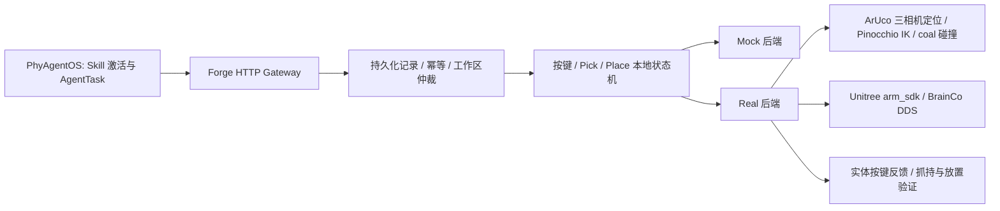

# G1 中控台实体按键与桌面 Pick / Place

面向 **G1 EDU 29 自由度、BrainCo Revo2、头部 D435i、左右腕 D405** 的独立执行运行时。通过当前 Core 的 Forge Tool API / Skill Runtime 接入；不使用 VLA，不需要模型服务即可运行离线演示。文本模型只选择目标和动作，关节控制与结果判断在本地完成。

实现范围是：**已标定中控面板的实体按键，带标记的已知刚性小物体抓取与放置**。左右臂都可选，首次版本串行占用整个双臂工作区，不执行同时双臂协作、移动、叠衣服、任意散乱物体抓取。实机后端已经写入代码，但任何离线测试都不等于用户这台机器人已经完成接机验收。

准备部署到 Linux 并连接真机，请从 [Linux 部署与真机接入手册](DEPLOYMENT_LINUX.zh-CN.md) 开始，并复制填写 [现场部署与验收记录](SITE_ACCEPTANCE.zh-CN.md)。手册包含从个人仓库 clone、依赖安装、厂家服务、标定、反馈、API/Skill 接入和后续更新。

源码在 [zztyac/phyagent](https://github.com/zztyac/phyagent) 的 `codex/g1-console-pick-runtime` 分支。Linux 安装 Git 后，在尚无 `~/phyagent` 目录时执行：

```bash
cd "$HOME"
git clone --depth 1 --branch codex/g1-console-pick-runtime https://github.com/zztyac/phyagent.git phyagent
cd "$HOME/phyagent"
git branch --show-current
```

接着按手册第 2 节建立 `~/g1-site/venv` 和 `~/g1-site/config/runtime-env.sh`。源码在 `~/phyagent`，现场模型、标定、真实配置和执行数据库在 `~/g1-site`，不随 clone 提供。上游 `v1.1.0` 标签不含本集成；不要切回该标签部署。

## 结构与执行闭环



| 代码 | 作用 |
| --- | --- |
| `src/g1_tabletop/runtime.py` | 新鲜观测引用、按键/抓取/放置状态机、取消和结果确定性 |
| `store.py`、`ownership.py` | SQLite 日志、请求幂等、重启不重放、进程与硬件资源锁 |
| `gateway.py`、`specs.py` | 7 个严格参数工具、Action 生命周期、三路图像及状态 WebSocket |
| `backends/real.py` | 本地规划、执行、监控、反馈验证和停止确认 |
| `drivers/` | Unitree HG DDS、BrainCo Revo2、RealSense 适配 |
| `kinematics.py`、`perception.py` | 29 关节映射、FK/IK、重力补偿、碰撞、标记姿态 |
| `calibration.py`、`feedback_bridge.py` | 离线相机标定、标记生成、现场反馈文件到 HTTP 的只读桥 |
| `skill/`、`scripts/build_bundle.py` | manifest v2 Skill、Node 源码包、schema v3 本地索引 |

按键执行：获取实体反馈基线 → 指向手型 → 预接触 → 腕相机修正 → 有界按压 → 释放回撤 → 核验同一来源/epoch 下新增且仅新增一次事件。`ensure_state` 在已达到指定状态时不按压。位置到达不算按键成功；未确认触发或中途中断时保留 `unknown`，不得盲目重按。

抓取执行：预抓取 → 腕相机修正 → 靠近 → 持久化“可能持有” → 合手 → 小幅抬升 → 连续图像与手电流确认。成功后手保持占用。放置执行：确认仍持有 → 定位放置区 → 下放 → 张手 → 回撤 → 连续图像确认 → 释放占用。物体标记必须在验证阶段可见。

## 现在即可运行（不接真机）

完成 [Linux 手册第 2 节](DEPLOYMENT_LINUX.zh-CN.md#linux) 的 Python 3.11 环境安装后执行；每个新终端先 source 环境文件：

```bash
source "$HOME/g1-site/config/runtime-env.sh"
cd "$G1_REPO"
python -m g1_tabletop demo
python -m pytest integrations/g1-tabletop/tests -q
python -m g1_tabletop doctor --config integrations/g1-tabletop/config/mock.json
python -m g1_tabletop serve --config integrations/g1-tabletop/config/mock.json --state-dir "$G1_TABLETOP_STATE_DIR" --require-mode mock
```

`demo` 使用临时数据库完成一次按键、左手抓取和放置，输出 `physical_hardware_used: false`。Mock 图像是合成占位图；视觉算法另有投影几何及标定数据测试。Gateway 仅绑定 `127.0.0.1:19002`，接口说明在 `/docs`，健康检查在 `/health`。

独立启动 Gateway 不会自动激活 Core 的 Skill；完整 Core 工作流需要后文的 Skill 安装与启动。测试覆盖真实 Core 客户端及 Skill 激活/绑定链路，而非只调用状态机函数。

HTTP 观察→按压→结果示例统一见 [手册第 7.3 节](DEPLOYMENT_LINUX.zh-CN.md#commissioning)。示例检查 Mock 模式，保存原始请求和 invocation ID，并有轮询时限；在另一个已加载环境的终端运行。

同一业务请求重试必须使用相同 `caller_id` 和参数。HTTP 202 只代表受理；最终 `result.status` 才是执行结论。新动作前重新观察。返回 `unknown` 后读取状态/诊断并人工处理；不要换 caller ID 或删数据库继续动作。

## 接入当前 PhyAgentOS

完整流程见 [手册第 8 节](DEPLOYMENT_LINUX.zh-CN.md#core)。首次部署推荐已做离线验证的 Linux x86_64；aarch64 仍需原生依赖和实机验收。先安装运行时依赖、Dora CLI **0.4.1**，完成 Core 初始化并停止独立 Gateway，然后进行首次 Skill 安装：

```bash
source "$HOME/g1-site/config/runtime-env.sh"
cd "$G1_REPO"
python -m pip install 'dora-rs==0.4.1'
python integrations/g1-tabletop/scripts/build_bundle.py --output dist/g1-release --arch x86_64
python -m http.server 18080 --bind 127.0.0.1 --directory dist/g1-release
```

保持静态服务器运行，在另一个终端执行：

```bash
source "$HOME/g1-site/config/runtime-env.sh"
cd "$G1_REPO"
paos skill install g1-tabletop --index dist/g1-release/index.yaml --yes
paos skill start g1-tabletop --profile mock
```

有 `mock`、`real`、`real-buttons` 三个 profile。`real-buttons` 支持配置中 `objects={}`、`placements={}` 的纯按键部署。切换前先停止当前 Skill。环境文件中 `G1_REAL_CONFIG` 指向 `$G1_SITE/config/site.json`，完成接机前置条件后启动 `--profile real` 或 `real-buttons`。

**Dora daemon 必须从已激活运行时虚拟环境且已设置这些变量的终端启动。** Node 启动器使用 `/usr/bin/env python3`。已经运行的 daemon 不会因另一个终端执行 `export` 而更新 PATH/环境。按项目现有 Dora 管理流程停止自己运行的 flow/daemon，再从正确环境启动；不要影响其他运行中的机器人任务。Core 会在需要时执行 `dora up`。

Node 归档包含源码、入口脚本、许可证和依赖清单，**不包含 Python 解释器、SDK 或模型资产**。不能将其当成离线自包含二进制。x86_64/aarch64 打包选项声明部署目标。后续更新遵循 [手册第 9.6 节](DEPLOYMENT_LINUX.zh-CN.md#operations)：`git pull` 不会替换已安装 Node；当前构建脚本固定版本 `0.1.0`，源码变更后的 Node 需要新的版本与 artifact ID，不能仅换输出目录后重复安装。

Core 使用普通 Forge Actions。未启用尚未完成真实 transport 接入的 interaction scheduler。无模型时使用验证 `off`；有审计模型时使用 `audit`。运行时结果负责物理事实；当前 Core 的语义验证不是确定性的实机安全控制器，不能靠模型的 `passed` 覆盖失败/unknown。

## 实机需要你提供的内容

| 输入 | 用途/限制 |
| --- | --- |
| BrainCo 完整型号、固件、左右手服务启动方式 | 本适配器针对 Unitree `brainco_hand_service` 的 **Revo2 六通道**；其他型号需另适配 |
| G1 固件版本、DDS 网卡/域、当前控制模式 | 只向 `rt/arm_sdk` 发布；15–28 为手臂，29 为融合权重；不能同时运行遥操作/其他手臂控制程序 |
| 与实机一致的 29-DOF URDF/mesh/SRDF | 固定基座模型；有碰撞几何、经过审查的相邻连杆排除；文件摘要固定 |
| 左右 `point` / `grasp` TCP、手与相机外形包络 | 指尖、抓持中心、相机支架都参与定位与碰撞；不能仅用裸 G1 URDF |
| D435i / 左 D405 / 右 D405 序列号和外参 | 头部相对 base，腕相机相对 wrist；校验时间偏差、畸变与实际视频模式 |
| 中控台安装位置、各按键中心/方向/尺寸/行程 | 标记贴在刚性面板附近；按键相邻时指尖及误差预算必须落在可用区域内 |
| 按键反馈通道 | 试验台电气反馈、车辆接口或已验证的指示灯视觉模块；具体接入不能从照片推断 |
| 手型、关节增益/限位、可承受电流、工作区/障碍 | 必须由实机手册与低速调试确定；示例没有生产增益 |
| 物体质量/包络、抓持姿态、可见标记与放置区 | 只支持配置内的小型刚性物体；模型质量上限 0.5kg **不是** G1 可用载荷承诺 |

以上缺失不会阻塞离线开发。`config/real.site.template.json` 用 `null` 标出未测量字段，`commissioned=false`；它故意不能启动。复制后填现场数据，完成验收再设置 `commissioned=true`。该开关是操作员声明，不是自动认证。JSON Schema 在 `config/runtime.schema.json`。`doctor` 只检查配置、依赖和模型哈希，不连接设备，不证明动力学/外参准确。

现场按 [COMMISSIONING.md](COMMISSIONING.md) 完成标定与分阶段验证。按键反馈协议见 [FEEDBACK.md](FEEDBACK.md)。

## Linux 实机依赖

依赖命令统一维护在 [Linux 手册第 2、4 节](DEPLOYMENT_LINUX.zh-CN.md#drivers)：先安装约束文件中的原生库和单一 `opencv-python==4.14.0.94`，再构建 CycloneDDS、安装固定提交的 Python SDK2，最后部署 BrainCo 服务和 RealSense。不要额外安装 `[vision]` extra，它会引入与 SDK 共用 `cv2` 文件的另一个 OpenCV 发行包。

BrainCo 服务固定 DDS domain 0，启动时可能立即移动手指，不是只读服务。RealSense USB 权限、带宽、供电、D405 视频模式需现场验证。

上游仓库与参考提交固定在 [references.lock.json](references.lock.json)，没有把整套遥操作工程复制进 Core。当前实现不要求 ROS；URDF 模型可从 Unitree 仓库选取再补齐现场几何。生产部署应保存最终 Python 依赖快照和标定/固件版本。

## 控制与验证的实际边界

- 基座、腿和腰必须保持标定姿态；本模块不控制平衡，也不下发腿/腰目标。检查下肢关节与 IMU 漂移只能发现部分变化，不能替代物理支撑/定位或移动基座估计。车内座舱要额外建模方向盘、座椅、饰板和腕相机空间。
- 轨迹使用有速度/加速度限制的插值，并在离散采样点做 IK、工作区与碰撞检查。不是全局避障规划器，也不是连续碰撞无遗漏证明；若直达路径受阻会拒绝，需重新设计安全预姿态/安装布局。
- CPython/DDS 发布目标频率默认 250Hz，存在调度抖动，不是硬实时保证。DDS 写阻塞、进程崩溃、断电、控制权释放后的实机行为，需要硬件看门狗与实体急停验收。
- BrainCo `tau_est` 是电流 A，不是指尖力 N。没有可靠力传感器时，按键采用经标定的有限行程/速度和柔顺指尖；**没有实现精确牛顿级力控**。腕力传感器或额外接触传感器后续可接入本地控制层。
- 相机曝光时刻与 DDS 状态使用主机时间近似配对；DDS receipt timestamp 不是同步曝光触发。配置的偏差门限必须包含现场延迟误差，近接触前应充分停稳。
- 碰撞模型包括持物包络；实际柔性手指、线缆及夹持偏差要用保守外形覆盖。标定和成功阈值必须匹配按键尺寸，不能用默认毫米值直接保证精度。
- 单进程与同机同网卡/domain 的锁防止本项目重复控制；无法阻止另一台电脑或第三方程序发布 DDS。服务限本机，远程暴露需要另行部署访问控制。

## 验证和恢复

```bash
python -m ruff check integrations/g1-tabletop
python -m ruff format --check integrations/g1-tabletop
python -m pytest integrations/g1-tabletop/tests --cov=g1_tabletop -q
python integrations/g1-tabletop/scripts/export_examples.py
```

Windows 跑控制协议、故障注入、Core 绑定、HTTP/WebSocket、OpenCV 与打包检查；Linux 安装 Pinocchio 后另跑真实原生 FK/IK/碰撞接口和 Node 安装。CI 配置在 `.github/workflows/g1-tabletop.yml`。当前验证记录见 [VALIDATION.md](VALIDATION.md)。

重启后的未终结动作变成 `unknown`，持物状态保留，不自动重放。人工独立停止机器人并移除物体、确认双手空且张开后，可停掉 Gateway/Skill 再执行维护命令：

```bash
source "$HOME/g1-site/config/runtime-env.sh"
python -m g1_tabletop reconcile-empty --config "$G1_REAL_CONFIG" --state-dir "$G1_TABLETOP_STATE_DIR" --confirm-stopped-and-empty --operator-note '已独立停机并检查双手空载，确认目标现场状态'
```

命令保留审计记录并保存头相机图像摘要；不作为 Agent 工具，也不发送张手/手臂移动命令。无法证明停止或手未张开时拒绝。未解决的执行/占用不能通过删除数据库解除。正常停机也不会发零位或自动掉落物体；应用退出后持物与姿态保持不能仅依赖 Python 进程，应先在受控流程中放置物体并完成硬件控制交接。
